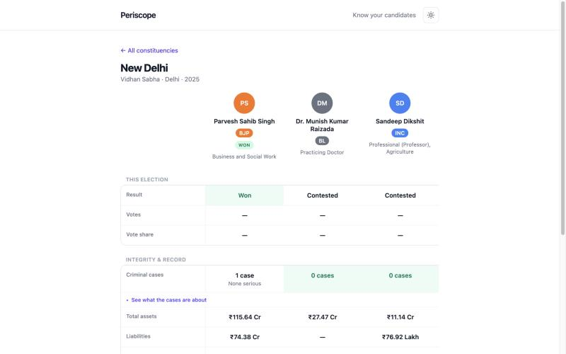

# Periscope

**Know your leader before you choose them.** Periscope puts the candidates in an Indian election side by side:
criminal cases, declared assets and liabilities, education, profession and party, so voters can compare them in seconds.

**Live:** [periscope-psi.vercel.app](https://periscope-psi.vercel.app)



## What it does
- Covers **41,800+ candidates across 31 state elections**, all 28 states plus Delhi, Puducherry and Jammu & Kashmir.
- Look up your constituency by **6-digit pincode**, or browse by state.
- Compare every candidate in a constituency side by side: criminal cases (with the IPC sections involved), total assets,
  liabilities, education and profession, with the winner highlighted.
- Missing fields show as "—", never filled in or guessed.

## How it's built

```
 MyNeta affidavit pages ──► Wayback Machine snapshots ──► Python pipeline ──► per-state JSON ──► React app (Vite) ──► Vercel
                              (no rate limits)              requests + bs4      lazily loaded      TypeScript, Tailwind
```

| Part | Stack | Notes |
|---|---|---|
| Web app | React, TypeScript, Vite, Tailwind CSS, React Router | Each state's dataset is a separately loaded chunk, so opening one state never downloads another's data. |
| Data pipeline | Python, requests, BeautifulSoup | Scrapes Form 26 affidavit data and normalizes it into one JSON schema. |
| Hosting | Vercel | Static single-page app. |

### Engineering decisions
- **Archive-first scraping.** The source site rate-limits hard (blocked after ~30–40 sequential pages). The pipeline reads the
  Internet Archive's copies instead, which have no rate limits and work from any country. Winner flags come from the archived
  results pages, so no separate results dataset is needed.
- **Content-addressed cache.** Every fetched page is stored under its SHA-1, so re-running after a parser fix makes zero network
  requests and finishes in minutes.
- **One generic adapter.** `buildScrapedState()` turns any state's JSON into the app's domain model; adding a state is a
  ~30-line config file and a registry entry.
- **Conservative pincode lookup.** Only verified pincode-to-constituency mappings are used; unknown pincodes fall back to the state picker.
- **New-election discovery.** `python -m myneta_pipeline --discover` checks for newly published elections (run monthly).

## About the data in this repository
The real candidate dataset is **not included**. The source's terms discourage redistributing it, so every
`src/data/**/affidavits.*.json` file here is an empty sample, except Delhi, which has three **fictional** demo candidates in
New Delhi so the app runs. To work with real data, generate it with the pipeline below.

## Run it locally

```bash
nvm use            # Node 22 (see .nvmrc)
npm install
npm run dev        # http://localhost:5173  (try Delhi → New Delhi)
```

## Developer guide

### Pipeline: scrape a new state

```bash
cd pipeline
python -m venv .venv && source .venv/bin/activate
pip install -r requirements.txt
```

**Preferred: Wayback mode.** MyNeta rate-limits direct scraping hard (blocks after
~30-40 sequential pages, regardless of delay — we never got Bihar past 40% in three
attempts). The Wayback Machine has nearly every major recent election fully archived
(UP, Maharashtra, TN, Karnataka, WB, Bihar, Delhi, ...), and scraping the archive has
no rate limits and works from any country:

```bash
# 1. Check coverage (count of archived candidate pages; compare vs ADR's candidate count):
curl "http://web.archive.org/cdx/search/cdx?url=myneta.info/<Slug>/candidate.php*&output=text&collapse=urlkey&filter=statuscode:200" | grep -cv print=true

# 2. Scrape from the archive:
python -m myneta_pipeline.wayback --election Bihar2025 --state Bihar --year 2025 --out output/bihar2025.json
```

Winner flags (`is_winner`) come from the archived winners page, so no separate
results data is needed.

**Fallback: live scrape** (small states only; find the slug with `--list`):
```bash
python -m myneta_pipeline --state "Goa" --list
python -m myneta_pipeline --state "Goa" --year 2022 --out output/goa2022.json
```

**Check for new elections (monthly cron):**
```bash
python -m myneta_pipeline --discover
```

Everything fetched lands in `pipeline/.cache/` (SHA1-keyed), so re-runs — e.g. to
re-parse after a parser fix — make zero live requests and finish in minutes.

### Wire a new state into the app

Since the wayback scrape carries winner flags, a new state needs **no curated
results data** — the generic adapter builds everything from the JSON:

1. Copy JSON: `cp pipeline/output/<state><year>.json src/data/<state>/affidavits.<state><year>.json`
2. Create `src/data/<state>/<state>Data.ts` (~30 lines — copy `src/data/delhi/delhiData.ts`,
   change state name / year / JSON import). It calls `buildScrapedState()` from
   `src/data/scrapedState.ts`.
3. Regional parties: pass extras to `createPartyResolver()` (see `src/data/goa/parties.ts`
   for the pattern; national parties like BJP/INC/AAP/BSP are already in
   `src/data/partyResolver.ts`).
4. Register the state in `src/data/states.ts` (`AVAILABLE_STATES`).
5. Concat its arrays into the repository in `src/data/index.ts`.
6. Optional: add the state's pincodes to `src/data/pincode-map.ts`.

(Goa predates this flow and additionally overlays curated vote counts — that older
pattern lives in `src/data/goa/goaData.ts` and is only needed if you want per-candidate
vote numbers, which the affidavit scrape doesn't carry.)

### Build for production

```bash
npm run build
```

Output goes to `dist/`.

### Data & publishing notes

- MyNeta/ADR data is for **local prototyping only** — their ToS discourages
  redistribution. Before publishing, get ADR's written permission (adr@adrindia.org)
  or switch to the ECI pipeline (`pipeline/eci_pipeline/`, needs an India-IP server).
- Optional/missing affidavit fields render as "—", never fabricated.
- Pincode lookup is conservative: only verified pincodes are mapped; unknown pincodes
  fall back to the state dropdown. Partial is better than wrong.
